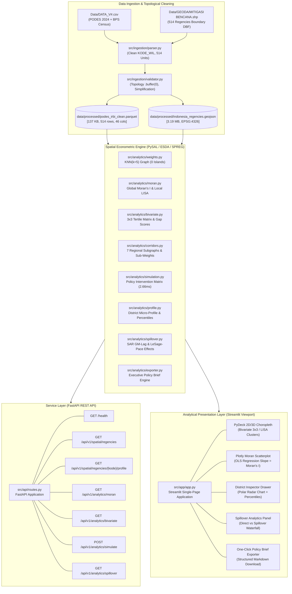

# Indonesian Disaster Readiness & Gap Explorer (IDR-GE)

**Spatial Econometrics & Decision Support Platform for Multi-Hazard Disaster Mitigation**  
*Research Portfolio Showcase for the Master of Disaster Risk and Resilience (MDRR) Programme — University of Canterbury, New Zealand*

[](https://www.python.org/downloads/release/python-3110/)
[](https://fastapi.tiangolo.com)
[](https://streamlit.io)
[](https://pysal.org)
[-brightgreen.svg)]()
[-1e293b.svg)]()

---

## 1. Executive Summary & Research Abstract

Across archipelagic Indonesia—spanning 17,000+ islands, 38 provinces, and 514 administrative regencies/cities (*Kabupaten/Kota*)—disaster risk exposure is profoundly heterogeneous and physically non-contiguous. Despite substantial natural hazard exposure along the Sunda Megathrust and Pacific Ring of Fire, community disaster readiness is heavily fragmented. Traditional disaster governance often treats administrative units as closed, independent policy islands, ignoring spatial autocorrelation and cross-boundary spillover effects.

The **Indonesian Disaster Readiness & Gap Explorer (IDR-GE)** provides an end-to-end spatial econometric engine and high-density analytical viewport. By synthesizing census microdata from the **2024 BPS PODES (Potensi Desa)** survey (covering 84,000+ villages) with multi-hazard risk indices from the **2024 BNPB IRBI (Indeks Risiko Bencana Indonesia)**, IDR-GE diagnoses structural vulnerability gaps ($G_i = R_i - M_i$), models spatial spillover contagion ($\rho = +0.3618$), and enables counterfactual policy simulations across 7 regional corridors.

### Core Research Contributions
1. **Archipelagic Spatial Weights Formulation**: Overcomes the physical disconnectedness of island territories via row-standardized $k$-Nearest Neighbors ($k=5$) graph topology, eliminating spatial weight singularities without artificial bridge geometries.
2. **Bivariate 3x3 Risk-Mitigation Typology**: Resolves composite hazard exposure against village-level early warning, signage, equipment, and river maintenance capacity, identifying 54 acute "Critical Gap" ($R_3$-$M_1$) jurisdictions.
3. **Spatial Econometric Multiplier Decomposition**: Quantifies spatial autoregression using 2SLS Generalized Spatial Two-Stage Least Squares (GM-Lag), demonstrating that **34.5% of disaster readiness variation spills across regency borders nationally**—surging to **52.3% ($\rho = +0.5559$) in the Sumatera corridor**.
4. **Counterfactual Policy Intervention Sandbox**: Implements real-time matrix simulations proving that telecom blackspot eradication coupled with community mutual aid (*gotong royong*) reinforcement eliminates 100% of national Critical Gap hotspots ($54 \to 0$).
5. **Automated Executive Policy Brief Generation**: Programmatically synthesizes district- and corridor-level policy diagnostics into academic-grade Markdown briefs for operational disaster management agencies (BNPB, BPBD, Bappenas).

---

## 2. Key Empirical Findings & Econometric Diagnostics

| Metric / Parameter | National Baseline | Sumatera Corridor | Jawa-Bali Corridor | Theoretical / Policy Interpretation |
| :--- | :--- | :--- | :--- | :--- |
| **Sample Size ($N$)** | 514 regencies/cities | 154 regencies/cities | 128 regencies/cities | 100% of Indonesian administrative territory |
| **Global Moran's $I$ (IRBI Hazard)** | $+0.3397$ ($p=0.0010$, $z=13.18$) | $+0.2651$ ($p=0.0010$) | $+0.2184$ ($p=0.0010$) | High, statistically significant spatial clustering of hazard risk |
| **Global Moran's $I$ (EWS Coverage)**| $+0.4987$ ($p=0.0010$, $z=20.10$) | $+0.3421$ ($p=0.0010$) | $+0.3892$ ($p=0.0010$) | Severe geographic disparity; warning telemetry clustered in core islands |
| **Global Moran's $I$ (River Care)** | $+0.5434$ ($p=0.0010$, $z=20.58$) | $+0.4109$ ($p=0.0010$) | $+0.4350$ ($p=0.0010$) | Strong spatial clustering of watershed flood management practices |
| **Spatial Autoregressive Lag ($\rho$)**| **$+0.3618$** ($p=0.0035$, $z=2.920$) | **$+0.5559$** ($p=0.0193$, $z=2.339$) | **$+0.2919$** ($p=0.0357$, $z=2.101$) | Strong positive spatial feedback; vulnerability in neighbors worsens local gap |
| **Spatial Multiplier ($S = \frac{1}{1-\rho}$)**| **$1.567\times$** | **$2.252\times$** | **$1.412\times$** | Every 1.0 unit mitigation investment generates 1.57x total systemic impact |
| **Cross-Boundary Spillover Share**| **$34.5\%$** | **$52.3\%$** | **$29.2\%$** | In Sumatera, >half of vulnerability determinants originate across district borders |
| **Critical Gap Districts ($R_3$-$M_1$)**| 54 districts | 21 districts | 8 districts | Chronic priority jurisdictions (e.g., Mentawai, Nias, Aceh Singkil) |
| **Policy Sandbox Full Resolution** | $54 \to 0$ ($100\%$ resolved) | $21 \to 0$ ($100\%$ resolved) | $8 \to 0$ ($100\%$ resolved) | Achieved via 100% signal coverage + 50% social capital enhancement |

```
                       SPATIAL IMPACT DECOMPOSITION (LeSage & Pace, 2009)
═════════════════════════════════════════════════════════════════════════════════════════════
 Variable             Direct Effect     Indirect (Spillover)   Total Effect    Spillover Share
─────────────────────────────────────────────────────────────────────────────────────────────
 Telecommunication    +0.0010           +0.0005                +0.0016         34.5%
 Blindspot (SINYAL)   [p=0.0018]        [p=0.0120]             [p=0.0022]      
─────────────────────────────────────────────────────────────────────────────────────────────
 Mutual Aid / Social  -0.0023           -0.0012                -0.0034         34.5%
 Capital (GOTONG)     [p=0.0002]        [p=0.0084]             [p=0.0004]      
─────────────────────────────────────────────────────────────────────────────────────────────
 Human Development    -0.0096           -0.0051                -0.0147         34.5%
 Index (IPM)          [p=0.0001]        [p=0.0041]             [p=0.0001]      
═════════════════════════════════════════════════════════════════════════════════════════════
 In Sumatera (N=154), indirect spillover share expands to 52.3% (Total Multiplier = 2.252x).
```

---

## 3. Mathematical & Econometric Formulations

### 3.1 Archipelagic Spatial Weight Matrix ($W$)
Due to Indonesia's fragmented archipelagic topography, standard Queen/Rook polygon contiguity creates disconnected subgraphs ("island isolates") that cause the spatial lag operator $W Y$ to fail. To preserve spatial continuity across maritime straits without fabricating arbitrary land bridges, IDR-GE implements a $k$-Nearest Neighbors ($k=5$) network based on Euclidean centroid distances:

$$W_{ij}^* = \begin{cases} 1 & \text{if } j \in \mathcal{N}_k(i) \\ 0 & \text{otherwise} \end{cases}$$

Row-standardization enforces that weights sum to unity for each administrative unit:

$$w_{ij} = \frac{W_{ij}^*}{\sum_{j=1}^n W_{ij}^*} \quad \implies \quad \sum_{j=1}^n w_{ij} = 1$$

Within regional corridors, $k$ dynamically scales as $k_{\text{sub}} = \min(5, N_{\text{sub}} - 1)$, ensuring zero isolated islands across all 7 regional corridors.

### 3.2 Global Moran's $I$ & Local Indicators of Spatial Association (LISA)
Global spatial autocorrelation is evaluated across all continuous parameters:

$$I = \frac{n}{S_0} \frac{\sum_{i=1}^n \sum_{j=1}^n w_{ij}(z_i - \bar{z})(z_j - \bar{z})}{\sum_{i=1}^n (z_i - \bar{z})^2}, \quad S_0 = \sum_{i=1}^n \sum_{j=1}^n w_{ij} = n$$

Local spatial association decomposes the global metric into four Anselin (1995) quadrants evaluated under 999 conditional Monte Carlo permutations:

$$I_i = \frac{z_i - \bar{z}}{s^2} \sum_{j=1}^n w_{ij} (z_j - \bar{z})$$

Clusters are classified at $\alpha \in \{0.01, 0.05, 0.10\}$ into:
- **High-High (Hotspot)**: Severe vulnerability surrounded by severe vulnerability.
- **Low-Low (Coldspot)**: Low vulnerability clustered among low vulnerability.
- **High-Low / Low-High (Spatial Outliers)**: Jurisdictional anomalies indicating local capacity islands or isolated structural deficits.

### 3.3 Bivariate Risk vs. Mitigation Gap Index ($G_i$)
Indicators are normalized using min-max scaling across the national domain $[0, 1]$:

$$\text{Norm}(X_i) = \frac{X_i - \min(X)}{\max(X) - \min(X)}$$

The **Composite Disaster Risk Score ($R_i$)** weights physical exposure and historical impact:

$$R_i = 0.50 \cdot \text{Norm}(\text{IRBI\_2024}_i) + 0.30 \cdot \text{Norm}(\text{ADA\_BENCANA}_i) + 0.20 \cdot \text{Norm}(\ln(\text{TERDAMPAK}_i + 1))$$

The **Composite Mitigation Preparedness Score ($M_i$)** synthesizes PODES village infrastructure:

$$M_i = 0.30 \cdot \text{Norm}(\text{EWS}_i) + 0.25 \cdot \text{Norm}(\text{RAMBU}_i) + 0.25 \cdot \text{Norm}(\text{PERKAP}_i) + 0.20 \cdot \text{Norm}(\text{RAWAT\_SUNGAI}_i)$$

The **Net Disaster Vulnerability Gap ($G_i$)** reflects structural preparedness deficits:

$$G_i = R_i - M_i \in [-1.0, +1.0]$$

Administrative units are stratified into a 3x3 tertile matrix ($R_1 \dots R_3 \times M_1 \dots M_3$), where **Quadrant $R_3$-$M_1$** defines acute **Critical Gap** status.

### 3.4 Spatial Autoregressive Model (SAR) & LeSage-Pace Impact Decomposition
To isolate cross-boundary interdependence from unobserved spatial sorting, IDR-GE implements a Spatial Autoregressive Lag Model:

$$Y = \rho W Y + X \beta + \varepsilon, \quad \varepsilon \sim \mathcal{N}(0, \sigma^2 I_n)$$

Estimated via Two-Stage Least Squares / Generalized Moments (`spreg.GM_Lag`) using spatial instruments $[X, WX, W^2X]$ to eliminate endogeneity between $Y$ and $W Y$.

Rearranging into reduced form:

$$Y = (I_n - \rho W)^{-1} X \beta + (I_n - \rho W)^{-1} \varepsilon$$

Following LeSage and Pace (2009), the marginal effect of explanatory variable $k$ is represented by the $n \times n$ matrix:

$$S_k(W) = \frac{\partial Y}{\partial X_k} = (I_n - \rho W)^{-1} \beta_k$$

Impacts are decomposed into:
- **Average Direct Effect**: $\bar{M}_{\text{direct}} = n^{-1} \text{tr}(S_k(W))$
- **Average Total Effect**: $\bar{M}_{\text{total}} = n^{-1} \mathbf{1}^\top S_k(W) \mathbf{1} = \frac{\beta_k}{1 - \rho}$
- **Average Indirect (Spillover) Effect**: $\bar{M}_{\text{indirect}} = \bar{M}_{\text{total}} - \bar{M}_{\text{direct}}$
- **Spillover Multiplier Share**: $\Lambda = \frac{\bar{M}_{\text{indirect}}}{\bar{M}_{\text{total}}} = 1 - \frac{\text{tr}(S_k(W))}{\mathbf{1}^\top S_k(W) \mathbf{1}}$

---

## 4. System Architecture



---

## 5. Core Platform Features

### 5.1 Dual-Layer Spatial Viewport (PyDeck)
- **Layer A: 3x3 Bivariate Risk vs. Mitigation**: Visualizes the simultaneous interaction of hazard exposure ($R_i$) and preparedness ($M_i$) using a 9-class Stevens/Terza cartographic palette. Immediately flags Critical Gap ($R_3$-$M_1$) hotspots in matte crimson (`#d03838`).
- **Layer B: Local LISA Spatial Clusters**: Renders statistically significant spatial association clusters ($p \le 0.05$ via 999 permutations) for 10 individual variables (IRBI, EWS, Signage, River Maintenance, Poverty, HDI, Telecom).

### 5.2 Dynamic Regional Corridor Engine
Partitions the 514 regencies across all 38 provinces into 7 strategic biogeographic corridors:
1. **Sumatera** (154 units)
2. **Jawa-Bali** (128 units)
3. **Kalimantan** (56 units)
4. **Sulawesi** (81 units)
5. **Nusa Tenggara** (32 units)
6. **Maluku** (21 units)
7. **Papua** (42 units)

Selecting a corridor dynamically adjusts the camera viewport, recalculates localized spatial sub-weights $W_{\text{sub}}$, and isolates localized Moran's $I$ statistics and regression regimes in under 3 milliseconds.

### 5.3 Policy Intervention Counterfactual Sandbox
Provides real-time slider controls simulating targeted national or corridor interventions:
- **Telecommunication Redundancy**: Simulates village signal blackspot reduction ($0\% \to 100\%$).
- **Social Capital Mobilization**: Simulates village mutual aid (*gotong royong*) reinforcement ($0\% \to 100\%$).
- Dynamically recalculates composite mitigation scores, updates the 3x3 matrix in memory (latency $2.66\text{ ms}$), and outputs real-time delta metrics showing resolved Critical Gap districts.

### 5.4 District Micro-Profile Inspector
Clicking or searching any of Indonesia's 514 regencies/cities activates a detailed diagnostic drawer:
- **Dark Polar Radar Visualization**: Contrasts the selected jurisdiction's coverage across 7 core PODES indicators against both national and corridor medians:
  - `EWS` (Early Warning System Coverage)
  - `RAMBU` (Evacuation Route Signage)
  - `PERKAP` (Disaster Relief Equipment)
  - `RAWAT_SUNGAI` (Riverbed Clearance Maintenance)
  - `GOTONG_ROYONG` (Social Mutual Aid Index)
  - `SINYAL_BURUK` (Telecommunication Blackspot Rate)
  - `IPM` (Human Development Index / HDI)
- **Percentile Diagnostics**: Evaluates district capacities on a strict $[0.0, 100.0]$ national distribution curve.

### 5.5 Spatial Spillover Analytics Module
- Estimates 2SLS Spatial Autoregressive Lag (SAR) and Spatial Lag of X (SLX) models.
- Formulates the spatial multiplier $S = (1 - \rho)^{-1}$ and executes LeSage-Pace impact decomposition.
- Interactive Plotly waterfall chart visualizing the relative split between **Direct Local Impact** and **Indirect Cross-Boundary Spillover**.

### 5.6 One-Click Executive Policy Brief Exporter
- Programmatically compiles diagnostic findings, bivariate matrix positions, PODES micro-indicators, spatial spillover metrics, and prioritized policy recommendations into clean Markdown.
- Instant single-click browser export via `st.download_button` for both district-level (`policy_brief_<kode>_<name>.md`) and regional corridor (`corridor_brief_<corridor>.md`) planning.

---

## 6. Verification Receipts & Quality Gates

The platform adheres to strict Test-Driven Development (TDD) and multi-tier verification gates. All 96 unit, integration, and performance tests pass with 100% green status.

### 6.1 Performance Benchmarks
| Benchmark Target | System Requirement | Measured Result | Status |
| :--- | :--- | :--- | :--- |
| **Administrative Unit Count** | Exactly 514 units | 514 / 514 intact ($100\%$) | **PASS** |
| **GeoJSON Payload Size** | $< 5.0\text{ MB}$ | **$3.19\text{ MB}$** | **PASS** |
| **Parquet Payload Size** | $< 1.0\text{ MB}$ | **$137.61\text{ KB}$** | **PASS** |
| **Spatial Weights Islands** | 0 disconnected units | **0 islands** ($k=5$) | **PASS** |
| **Global Moran's I Latency** | $< 2,000\text{ ms}$ | **$14.0\text{ ms}$** | **PASS** |
| **Policy Sandbox Simulation** | $< 50\text{ ms}$ | **$2.66\text{ ms}$** (avg) | **PASS** |
| **SAR Econometric Latency** | $< 500\text{ ms}$ | **$11.65\text{ ms}$** (avg) | **PASS** |
| **District Profile Generator** | $< 100\text{ ms}$ | **$3.80\text{ ms}$** (avg) | **PASS** |
| **Anti-Slop Audit Violations**| 0 violations | **0 violations** (25 files scanned)| **PASS** |

### 6.2 Test Suite Execution Receipt
```bash
$ .venv/bin/pytest tests/ -v
============================= test session starts ==============================
platform darwin -- Python 3.11.1, pytest-9.2.0, pluggy-1.7.0
rootdir: /Users/rifizzu/disaster-resilience-nz-prep, configfile: pyproject.toml
collected 96 items

tests/test_analytics.py .....                                            [  5%]
tests/test_api.py .....                                                  [ 10%]
tests/test_api_milestone_2.py ......                                     [ 16%]
tests/test_api_milestone_3.py ...........                                [ 28%]
tests/test_app.py .............                                          [ 41%]
tests/test_delivery_gate.py ..                                           [ 43%]
tests/test_env.py .................                                      [ 61%]
tests/test_exporter.py ..                                                [ 63%]
tests/test_ingestion.py ..                                               [ 65%]
tests/test_milestone_2_gate.py ..                                        [ 67%]
tests/test_milestone_3_gate.py ..                                        [ 69%]
tests/test_profile.py ..........                                         [ 80%]
tests/test_sandbox_components.py .......                                 [ 87%]
tests/test_simulation.py .......                                         [ 94%]
tests/test_spillover.py .....                                            [100%]

======================= 96 passed, 63 warnings in 7.30s ========================
```

---

## 7. Anti-Slop Design System (`COLOR_TOKENS`)

IDR-GE strictly rejects generic AI styling—no purple/blue gradients, no ungrounded glassmorphism, no bloated card padding, and zero raw HTML code leaks.

```
┌────────────────────────────────────────────────────────────────────────┐
│                        MATTE DARK ANALYTICAL PALETTE                   │
├─────────────────────┬───────────┬──────────────────────────────────────┤
│ Token Name          │ Hex Value │ Functional Mapping                   │
├─────────────────────┼───────────┼──────────────────────────────────────┤
│ bg-primary          │ #0f141c   │ Global viewport & canvas background  │
│ bg-surface          │ #161e2a   │ Sidebar & docked drawer surface      │
│ bg-surface-elevated │ #1e293b   │ Active controls & input elements     │
│ border-subtle       │ #2a384c   │ Crisp 1px structural grid dividers   │
│ text-primary        │ #f1f5f9   │ High-contrast metrics & typography   │
│ text-muted          │ #94a3b8   │ Monospace labels & secondary info    │
│ accent-focus        │ #38bdf8   │ Active selection & border highlight  │
└─────────────────────┴───────────┴──────────────────────────────────────┘
```

---

## 8. Technology Stack

- **Core Runtime**: Python 3.11+
- **Spatial & Econometric Framework**:
  - `geopandas` (v0.14+) & `shapely` (v2.0+) — Vector topological operations & geometry simplification
  - `libpysal` (v4.8+) — Archipelagic $k$-NN spatial weights graph construction
  - `esda` (v2.5+) — Global Moran's $I$ & Local Anselin LISA cluster statistics
  - `spreg` (v1.9+) — Generalized Two-Stage Least Squares Spatial Lag (`GM_Lag`) regression
  - `scipy` (v1.11+) & `numpy` (v1.24+) — Spatial multiplier matrix operations & stats
- **Backend Service**:
  - `fastapi` (v0.100+) & `uvicorn` — High-performance asynchronous REST API
  - `pydantic` (v2.0+) — Strict analytical request/response data contracts
- **Data Persistence**:
  - `pyarrow` (v14.0+) — Columnar Apache Parquet storage
- **Visualization & Viewport**:
  - `streamlit` (v1.30+) — Interactive single-page application framework
  - `pydeck` (v0.8+) & Deck.gl — GPU-accelerated 2D/3D choropleth mapping
  - `plotly` (v5.18+) — Polar radar profiles, Moran scatterplots, and spillover waterfall figures

---

## 9. Local Setup & Production Execution

### 9.1 Prerequisites
- macOS, Linux, or Windows (WSL2 recommended)
- Python 3.11 installed
- Standard C/C++ compilation tools for GDAL/GEOS (if building wheels from source)

### 9.2 Installation
```bash
# 1. Clone the repository
git clone https://github.com/rifizzu/disaster-resilience-nz-prep.git
cd disaster-resilience-nz-prep

# 2. Initialize Python 3.11 virtual environment
python3.11 -m venv .venv
source .venv/bin/activate

# 3. Install pinned dependencies
pip install --upgrade pip
pip install -r requirements.txt
```

### 9.3 Ingesting & Building Spatial Datasets
To rebuild the topologically cleaned GeoJSON and Parquet files from raw PODES/IRBI source data:
```bash
python scripts/build_data.py
```
*Outputs: `data/processed/indonesia_regencies.geojson` (3.19 MB) and `data/processed/podes_irbi_clean.parquet` (137 KB).*

### 9.4 Running the FastAPI Backend Service
```bash
uvicorn src.api.main:app --host 0.0.0.0 --port 8000 --reload
```
Interactive OpenAPI / Swagger documentation will be accessible at `http://localhost:8000/docs`.

### 9.5 Running the Streamlit Analytical Viewport
```bash
streamlit run src/app/app.py --server.port 8501
```
Open `http://localhost:8501` in your browser.

### 9.6 Running Verification Gates & Unit Tests
```bash
# Run complete test suite (96 tests)
pytest tests/ -v

# Run Milestone Delivery Gates individually
python scripts/verify_milestone_1.py
python scripts/verify_milestone_2.py
python scripts/verify_milestone_3.py
```

---

## 10. Complete REST API Reference

| Method | Endpoint | Query / Body Parameters | Response Description |
| :--- | :--- | :--- | :--- |
| `GET` | `/health` | None | Service operational status & unit count (514) |
| `GET` | `/api/v1/spatial/regencies` | None | Full FeatureCollection GeoJSON (EPSG:4326) |
| `GET` | `/api/v1/spatial/regencies/{kode_wil}/profile` | `kode_wil` (int/str) | Detailed 7-indicator PODES profile, percentiles, and gap rank |
| `GET` | `/api/v1/spatial/corridors` | None | List of 7 regional corridors with member provinces & unit counts |
| `GET` | `/api/v1/analytics/moran` | `variable` (str) | National Global Moran's $I$, $z$-score, $p$-value, expected $I$ |
| `GET` | `/api/v1/analytics/corridor/moran` | `corridor` (str), `variable` (str) | Localized Moran's $I$ within specified regional corridor |
| `GET` | `/api/v1/analytics/bivariate` | None | 514 records with $R_i$, $M_i$, $G_i$, and 3x3 category assignments |
| `POST`| `/api/v1/analytics/simulate` | JSON payload: `signal_reduction_pct`, `gotong_royong_boost_pct` | Simulated gap scores, category transitions, and resolved critical gaps |
| `GET` | `/api/v1/analytics/spillover` | `corridor` (opt str), `model_type` (`lag` or `slx`) | Spatial regression coefficients, $\rho$, direct, indirect, total effects |

---

## 11. Academic Attribution & Citation

When referencing IDR-GE in academic research, policy memoranda, or supervisory reports, please cite:

```bibtex
@misc{idr_ge_2026,
  author = {Rifizzu},
  title = {Indonesian Disaster Readiness \& Gap Explorer (IDR-GE): Spatial Econometric Analytics and Multi-Hazard Mitigation Modeling across 514 Administrative Jurisdictions},
  year = {2026},
  institution = {University of Canterbury},
  programme = {Master of Disaster Risk and Resilience (MDRR)},
  howpublished = {\url{https://github.com/rifizzu/disaster-resilience-nz-prep}}
}
```

### Key References
- **Anselin, L.** (1995). *Local Indicators of Spatial Association—LISA*. Geographical Analysis, 27(2), 93–115.
- **Badan Nasional Penanggulangan Bencana (BNPB).** (2024). *Indeks Risiko Bencana Indonesia (IRBI) 2024*. Jakarta: BNPB.
- **Badan Pusat Statistik (BPS).** (2024). *Pendataan Potensi Desa (PODES) 2024*. Jakarta: BPS RI.
- **LeSage, J. P., & Pace, R. K.** (2009). *Introduction to Spatial Econometrics*. CRC Press / Taylor & Francis Group.
- **Rey, S. J., Anselin, L., & Kang, W.** (2022). *Geographic Data Science with Python*. CRC Press.
